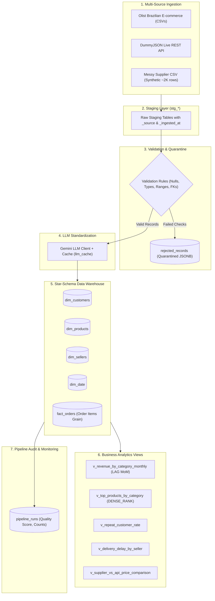

# RetailSync: Multi-Source ETL Data Pipeline


**RetailSync** is an automated, production-grade data pipeline that integrates, standardizes, and models e-commerce retail data from three distinct sources into a clean PostgreSQL star-schema data warehouse.

---

## Architecture Overview



---

## Tech Stack
* **Language**: Python 3.11+
* **Database**: PostgreSQL 16 (production target via Docker Compose) & SQLite fallback for zero-dependency local runs
* **Libraries**: SQLAlchemy, pandas, psycopg2-binary, Pydantic, Tenacity, Requests, Pytest, Python-dotenv
* **LLM Engine**: Google Gemini API (`google-generativeai`) with caching and graceful fallbacks
* **CI/CD**: GitHub Actions

---

## Quickstart

### 1. Clone & Set Up Virtual Environment
```bash
git clone <repository_url>
cd retailsync
python -m venv .venv

# On Windows PowerShell:
.\.venv\Scripts\Activate.ps1

# Install dependencies:
pip install -r requirements.txt
```

### 2. Configure Environment
```bash
cp .env.example .env
```
Edit `.env` with your database credentials or Gemini API key.

### 3. Initialize Database Schema
```bash
python -c "from src.load.db import init_schema; init_schema()"
```

### 4. Run Tests
```bash
pytest tests/
```

---

## Project Status

- [x] **Phase 1**: Repository scaffolding, Docker Compose, Star-Schema SQL, typed configuration, and structured logging.
- [ ] **Phase 2**: Multi-source ingestion (Olist, REST API, Supplier CSV generator).
- [ ] **Phase 3**: Validation engine and quarantined `rejected_records`.
- [ ] **Phase 4**: Idempotent warehouse loads and analytics views.
- [ ] **Phase 5**: LLM enrichment with caching and failure fallback.
- [ ] **Phase 6**: Pipeline monitoring, quality scoring, and alerting.
- [ ] **Phase 7**: End-to-end tests, documentation, and GitHub Actions CI/CD.
